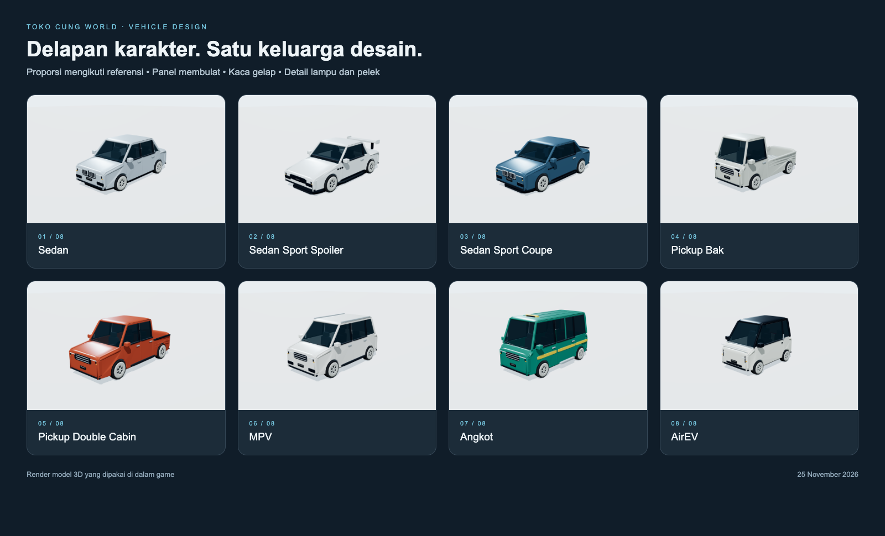

# Blueprint vehicle redesign — 25 November 2026

Eight silhouettes based on the supplied references, with the rounded painted panels and dark glazing of the existing TransJakarta bus. No downloaded car models, new dependency, or avatar rescaling.

| Display | Existing/new model ID | Seats |
| --- | --- | --- |
| Sedan | `car` | 4 |
| Sedan Sport Spoiler | `sport` (new) | 2 |
| Sedan Sport Coupe | `sedan` | 4 |
| Pickup Bak | `pickup` | 4, including two existing rear bed positions |
| Pickup Double Cabin | `double-cabin` (new) | 4 |
| MPV | `mpv`, `family-mpv` | 4 |
| Angkot | `angkot` | 4 |
| AirEV | `city-car` | 4 |

Capacity/economy of existing models is unchanged. MPV uses the family seven-seater silhouette, with the existing four playable positions. Coupe and AirEV have two physical side doors; rear passengers animate the front door on their side. Seats/floors of the sport variants sit lower so the existing avatars fit without changing scale. Pickup has an open bed with low rear benches. AirEV emits no exhaust smoke.

The existing 16 ambient vehicle IDs remain stable. All eight redesigned silhouettes appear, alongside convertible, bajaj and jeepney. Shared player parking adds `sport` at (81,99) and `double-cabin` at (81,106); compatible clients see eleven shared slots. Legacy six/nine-model clients keep their supported slots and IDs. AirEV/coupe and family MPV retain the existing Garasi ownership IDs and prices.

## Verification

- `node --experimental-strip-types --test tests/blueprint-vehicles.test.mjs tests/traffic.test.mjs`: eight-model coverage, stable fleet, true wheel cutouts, finite geometry, valid door hinges, NPC steering reach, and existing traffic rules.
- `node --experimental-strip-types scripts/check-vehicle-fit.mjs`: all models/seats with both avatar rigs and headwear; headroom, floor/feet, steering grip and seat transitions. Loader now supports the existing compressed avatar files.
- `node scripts/check-blueprint-cars-browser.mjs`: actual renderer, all eight front/rear previews, physical door rotation including rear passengers sharing a front door. Results: `render.json`.
- `VEHICLE_MODELS=car,sport,sedan,pickup,double-cabin,mpv,angkot,city-car QA_OUTPUT=/tmp/tokocung-blueprint-qa node scripts/check-cartoon-gallery.mjs`: four views with both seated avatar rigs and NPC variants; no page errors. NPCs add four render/shadow calls per vehicle.
- `WORLD_QA_BACKEND=/absolute/path/to/toko-cung QA_OUTPUT=/tmp/tokocung-blueprint-driving node scripts/check-vehicles-browser.mjs`: real Player/Rapier/HUD and Laravel services with temporary SQLite, synthetic identities and local transport. Two players claim/invite/accept, drive, brake, exit and disconnect; new models tested at their actual shared spawn positions.
- Backend `WorldMobilityTest`: 25 tests / 160 assertions, including six-to-nine-to-eleven compatibility, idempotent slots, new capacities and consent.
- TypeScript, focused ESLint and production build checked locally. No production deployment, production multiplayer transport, or physical-phone performance verification.

## Rollout

Release `WorldMobility` and `WorldVehicles` **before** the frontend; old backends reject the two new model IDs. No new migration or seed. Refresh clients to adopt the same model proportions and fleet variants. Existing room rows retain their IDs, including Garasi cars. The additional migrations in the local QA router only bring its disposable test database up to the existing production schema.
