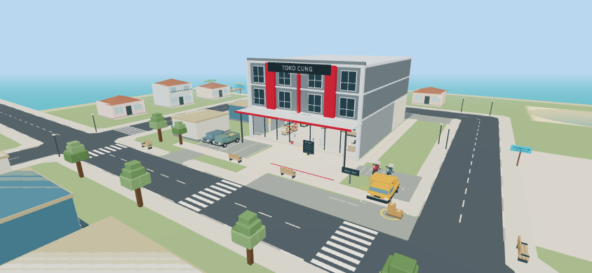
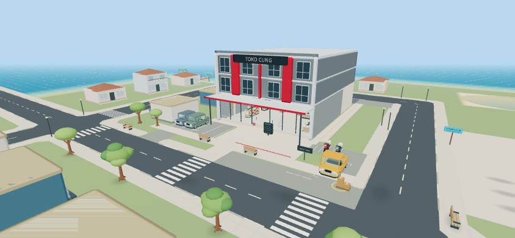
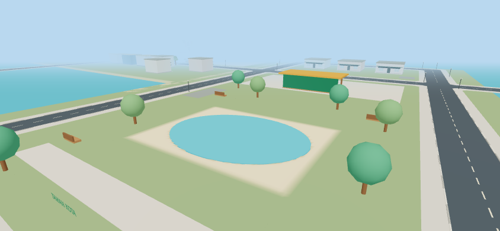
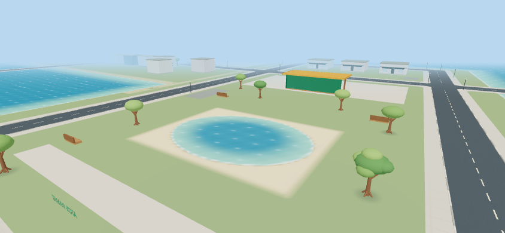
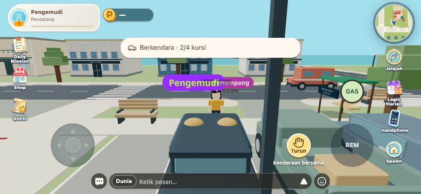
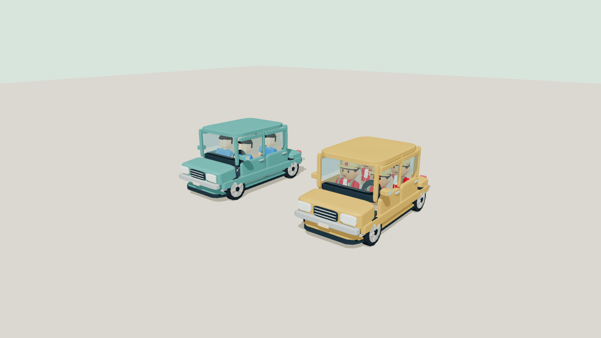
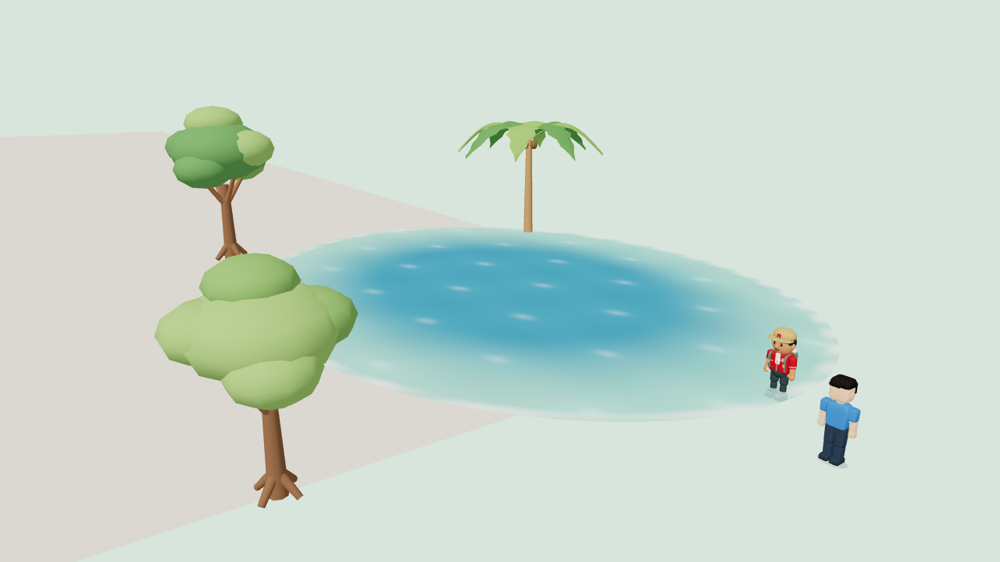

# Cartoon world QA — 9 November 2026

## Result and scope

Eight shared vehicle models now have hollow cabins, defined seats/doors/grips, moving wheels and suspension. Base and Explorer retain their original scale. Trees use branched trunks, roots and layered crowns; palms have curved serrated fronds. Water shares depth colour, highlights, shoreline foam and a bounded contact pool. Props use softened edges and lightweight contact shadows. Store layout, quest coordinates and economy are unchanged.

Frontend: four commits on `codex/soft-cartoon-world`, based directly on `main` (`9a7c7e9`). Companion backend: [MR !60](https://gitlab.com/encode21/toko-cung/-/merge_requests/60). Release backend first, frontend second, then refresh rooms. Transitions use existing occupants JSON; no new migration. No production deployment was performed.

## Before / after

| Before | After |
| --- | --- |
|  |  |
|  |  |
|  |  |

The vehicle comparison uses an in-world baseline and a controlled final gallery, not matching camera positions. [Gallery](gallery/) contains front, side, rear and three-quarter views for all eight models and both rigs. [Fit report](vehicle-fit.json) checks every seat, floor/roof clearance, driver grips and Explorer headwear using the actual rig assets. Gallery views and numeric bounds do not prove collision-free animation for every possible custom appearance.

## Same-route browser performance

Chrome headless with SwiftShader, touch viewport 844×390, DPR 1, fixed lighting, same store → market → park → return route and map fixture. Shadow maps are disabled in this paired fixture; adaptive quality starts at LOW. No other browser QA ran alongside the final measurement. FPS is rounded; p95 comes from frame samples. These are local browser measurements, **not physical-phone results** or a full multiplayer load test.

| Route | FPS before → after | p95 ms before → after | Draw calls before → after | Triangles before → after |
| --- | --- | --- | --- | --- |
| store | 60 → 60 | 17.6 → 17.4 | 567 → 569 | 247,876 → 440,492 |
| market | 60 → 60 | 17.4 → 17.5 | 585 → 588 | 250,452 → 448,548 |
| park | 60 → 60 | 17.5 → 17.4 | 589 → 592 | 255,152 → 453,046 |
| return | 60 → 60 | 17.5 → 17.6 | 567 → 569 | 247,876 → 440,492 |

Maximum draw-call increase: **0.52%** (target ≤15%). Maximum p95 increase: **0.57%** (target ≤10%). Colliders remain 112 at store/return and 145 in streamed districts. The added geometry raises triangles by about 78%; shared 44-triangle bevels reduced the initial final-scene total from roughly 698–717k to 440–453k. Physical midrange-phone memory, thermals and sustained FPS still require device testing. Raw paired data: [before.json](before.json), [after.json](after.json). Intermediate `vegetation.json` / `water.json` are development snapshots, not the final comparison.

## Checks

- `npx tsc --noEmit` and `npm run build` — passed. Build emits existing chunk-size/deprecation warnings.
- `node --experimental-strip-types scripts/check-vehicle-fit.mjs` — all eight models, seats, Base/Explorer rigs and Explorer headwear; driver grip reach, legacy seated data, transition endpoints and shared roll/lift transform passed.
- `node scripts/check-cartoon-gallery.mjs` — 32 screenshots, both rigs; no browser page errors.
- `WORLD_QA_BACKEND=/path/to/backend node scripts/check-vehicles-browser.mjs` — real Player/Rapier/HUD and Laravel services, two tabs with disposable identities/database. Car consent, movement/brake, passenger attachment, independent exits, an actual blocked-door collider and repeated input during entry; motorcycle two-finger gas/steer/brake, controls and disconnect cleanup.
- Backend `WorldMobilityTest` — **14 tests / 76 assertions**: reserved seats, replay idempotence, freeze, invitation consent, passenger/driver exits, room/disconnect/teleport cleanup and legacy JSON. New transition fields are additive.
- `node scripts/check-truck-browser.mjs` — complete road route through delivery completion, keyboard and two-finger touch controls, held brake/reverse/cancel, remote driver authority, disconnect, Spawn cancellation, three cashiers and interior camera. A focused rerun also covers the final shared suspension anchor.
- `node scripts/check-road-network.mjs`, `node scripts/check-traffic-fleet.mjs` — all six routes, sweep bounds, junctions, watchdog, 33 shared IDs and queues/handoffs passed.
- `node scripts/check-swimming-layout.mjs`, `node scripts/check-swimming-browser.mjs` — desktop/touch walk, shallows, swim, paddle, exit and dry roads/pier; shallow tire contact and pool bounds passed.
- `node scripts/check-cartoon-effects.mjs` — local/remote-shaped synthetic actors use actual avatar/effect components; wet emission, dry stop, bounded particles, reduced motion, SFX volume zero and mute passed. This is component QA, not a two-browser network splash test.
- `node scripts/check-world-feedback.mjs`, `node scripts/check-scene-time.mjs`, `node scripts/check-quest-actions.mjs` — sound attenuation/engine curves, time/light fades, quest revisions/session/reward guards passed.
- One-off geometry check — 44 triangles, outward winding, unit normals and unchanged unit bounds passed.

The original baseline vehicle harness hit a parked traffic obstacle and failed its movement assertion before these changes. Final QA uses a guarded test-only route to place cars/bikes on a clear road. The truck harness initially referenced an obsolete brake label; after updating it to the actual shared control, the full route and touch rerun passed. Neither initial failed attempt is counted as a pass.

## Remaining release verification

Physical midrange phones, production authentication/realtime transport, high latency/packet loss and sustained room load remain untested. The fixed-time gallery checks all seats; the live two-player browser run exercises a car and motorcycle, not every model/appearance combination. No full backend suite or unrelated UI suite was run. Preserve the existing adaptive tier, near-only interiors, instanced vegetation, capped shadow/particle pools and reduced-motion/audio preferences when extending assets.
