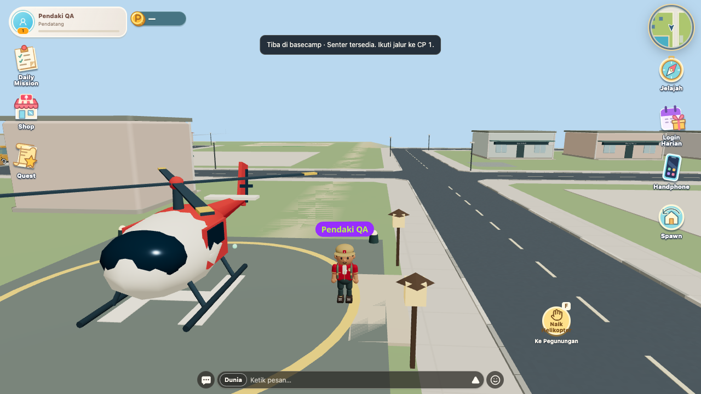
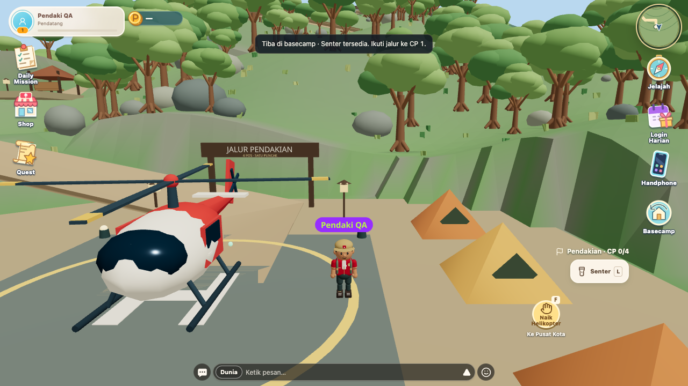
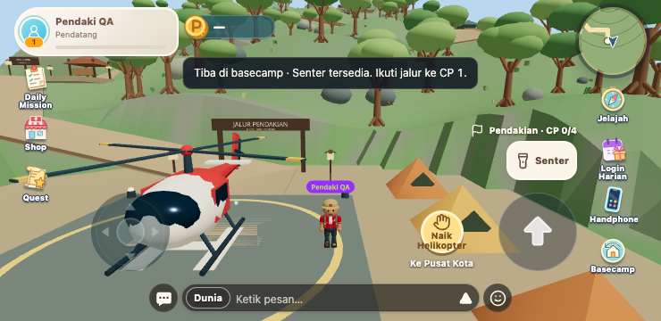

# Helicopter map transfer regression — 9 November 2026

The arrival toast appeared while the player remained at the city helipad. Reproduced from main `1b4cbbb`: after flight, the position reverted to `(65, 0.869, 49)`, `pendingTeleport` was already cleared and the toast said “Tiba di basecamp”. See [before state](before.json).

`GameCanvas` subscribes to the city/mountain region. When a teleport changes that region, it rerenders `Player`. The inline rigid-body `userData` object changed identity, making Rapier reapply mutable options and copy the previous rendered transform over the just-updated physics position. Keep that metadata stable for the lifetime of the player body. No backend/API, destination, map geometry or gameplay changes.

The former mountain fixture did not subscribe to region changes and passed despite this bug. It now reproduces that production subscription. The regression assertion waits after arrival and checks that physical position, HUD position, height and return-helicopter action remain at the destination. It fails before the fix and passes after.

| Before: arrival toast, still in city | After: actual mountain basecamp |
| --- | --- |
|  |  |

## Validation

- `node scripts/check-mountain-browser.mjs`: passed on desktop 1280×720 (60 Hz physics, full city collision) and touch 740×360 (40 Hz physics). Three round trips per viewport / twelve one-way flights, using actual F/button boarding and Player/Rapier/MountainRuntime. Every arrival stays at its destination after the region rerender.
- Duplicate boarding, movement reset, climbing, all four ordered checkpoints, fall rescue, summit, flashlight, map panels and leaving-room cancellation passed; no page errors. [Raw report](after.json).
- `node scripts/check-mountain-model.mjs`: passed sequential progress, one-time completion, respawns and connected trail.
- `npx tsc --noEmit` and `npm run build`: passed (existing build/deprecation warnings).

Chrome headless with SwiftShader and fixture backend transport; these are local browser results, not production or a physical phone. Frontend release only, followed by client refresh. No backend deployment or migration required. Production was not deployed.
