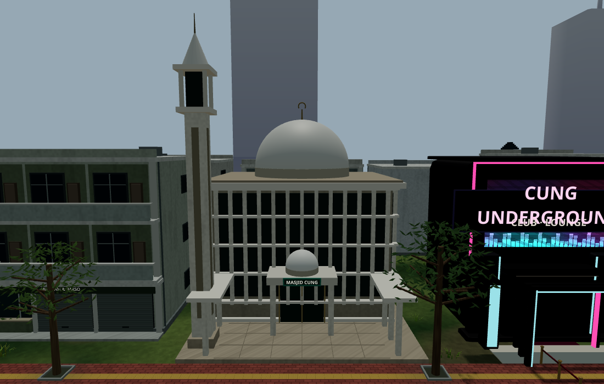
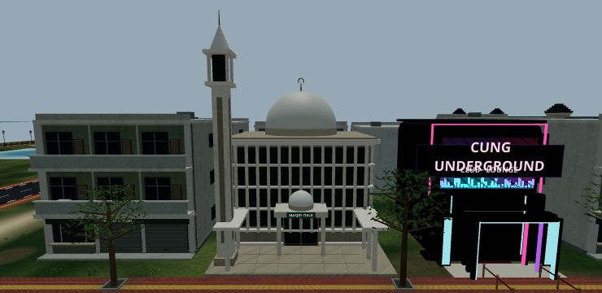

# Masjid Cung — 27 November 2026

Original procedural exterior inspired by the user-provided Istiqlal references, replacing the retired Principal parcel at (35, 35), beside Cung Underground. The supplied SketchUp URL returned 403; no external model or reference image is bundled into the game.

- Ivory concrete facade, large dome, smaller entrance dome, one slender minaret, covered portico and open tiled forecourt.
- 12 × 13 m footprint stays outside the sidewalk and neighboring lots. The old tree in front is moved to the edge of the forecourt.
- Three instanced facade batches: 114 instances, 17 meshes in the complete landmark. No added network requests or lights.
- Fixed collision for the plinth, hall, minaret, columns, roofs and domes; the central approach stays clear. Principal remains disabled.

## Verification

- `node --test tests/mosque.test.mjs tests/outdoor-layout.test.mjs`: 6 passed.
- `LANDMARKS_SHOTS=mosque-front,mosque-corner,mosque-night,mosque-mobile LANDMARKS_QA_OUTPUT=/tmp/tokocung-mosque-qa node scripts/check-landmarks-browser.mjs`: passed.
- Real Three/Rapier scene at 1100×700 and 740×360 touch viewport; front/corner/day/night captures, no JS errors. Physics ray checks cover courtyard-to-hall clearance, floor height, both domes, minaret and colonnade roof.
- TypeScript, targeted production-file ESLint and production build passed. Existing Three/Rapier deprecation and build chunk-size warnings remain.
- No physical-phone or production verification. Exterior only; no prayer/interior gameplay was requested.

