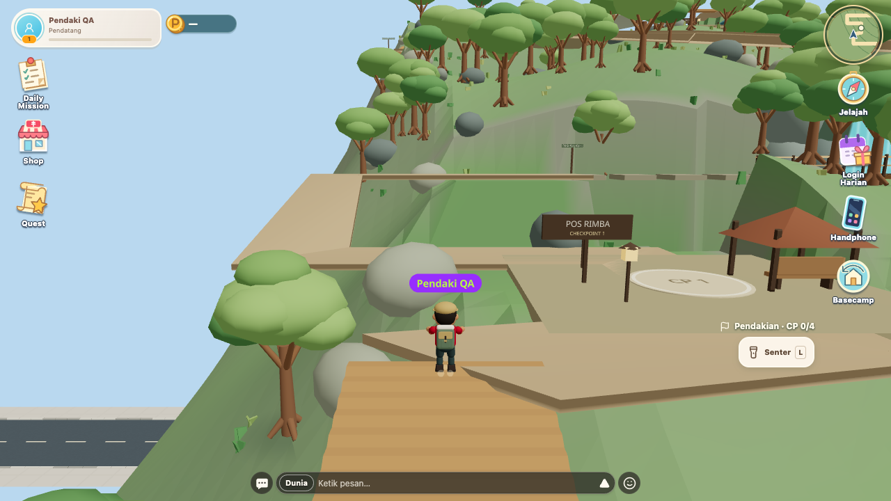
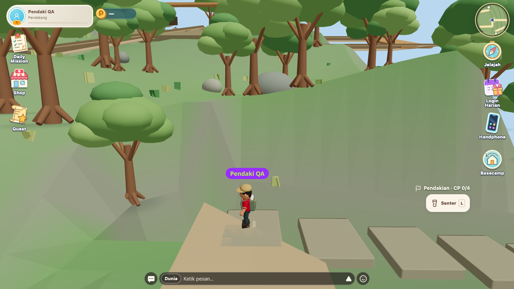
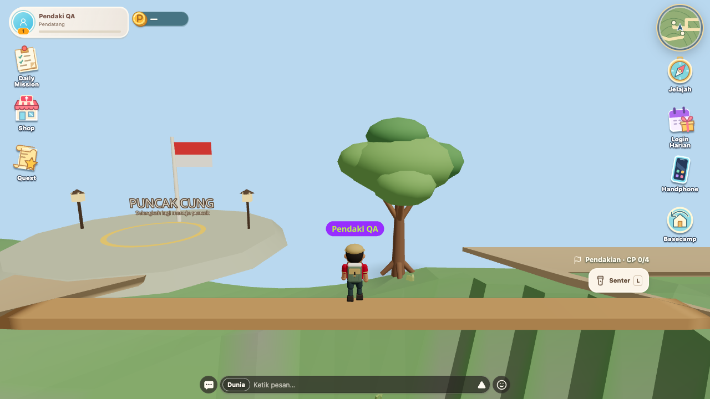
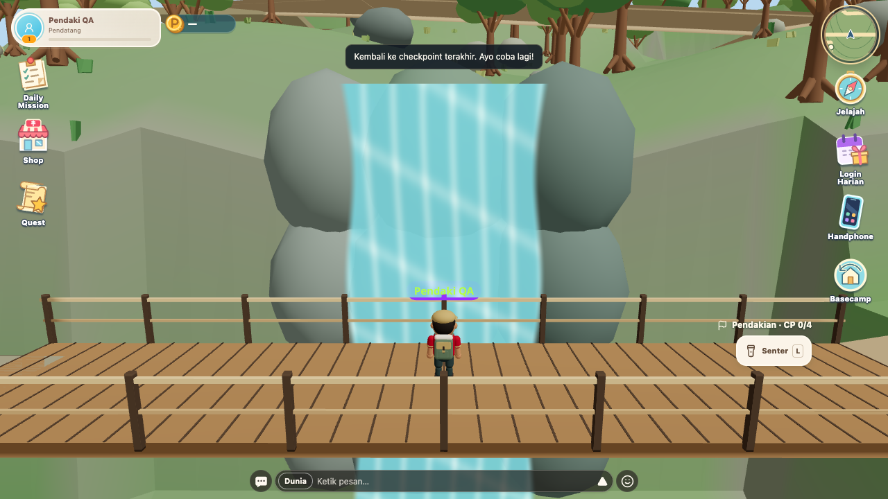
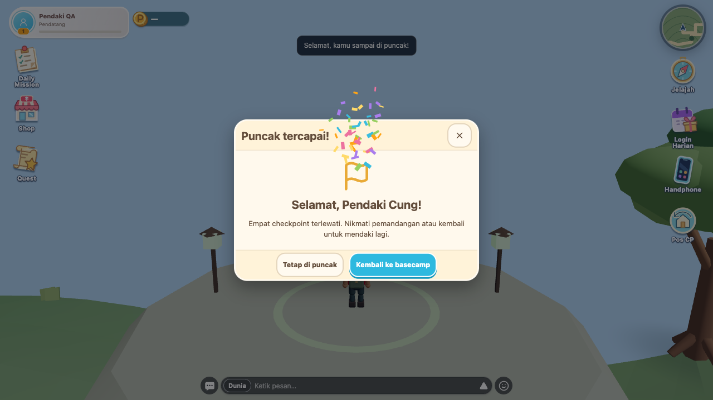
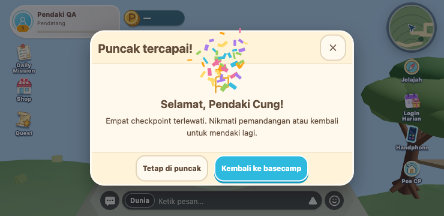
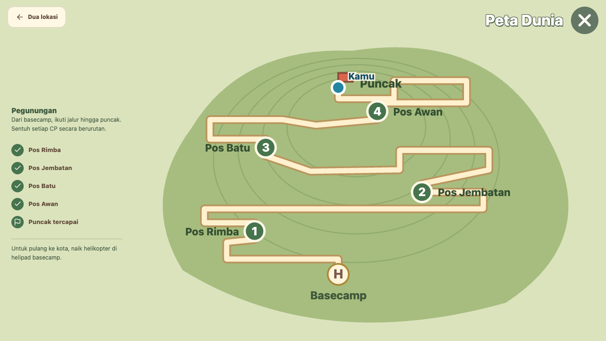
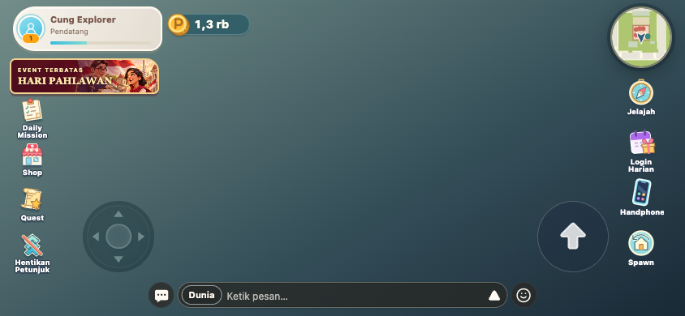
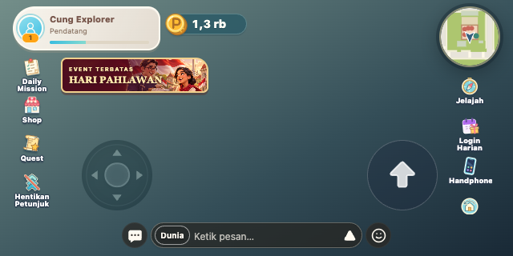

# QA jalur Obby Pegunungan — 10 November 2026

Jalur diperpanjang dari sekitar 299 m menjadi 625 m. Empat checkpoint, basecamp dan summit tetap di koordinat semula. Tiga tangga, dua rangkaian batu lompatan dan satu titian sempit memakai permukaan visual/collision yang sama. Jembatan memiliki air terjun dan buih ringan.

Melewati teras checkpoint, termasuk lompatan biasa, sekarang dihitung tanpa menginjak lingkaran. Urutan CP1–4 tetap wajib; terbang, digendong dan posisi terlalu tinggi/rendah tidak dihitung. Summit membuka confetti sekali dan pilihan tinggal atau kembali ke basecamp. Kembali mereset pendakian untuk percobaan baru; tombol tetap ada di HUD setelah modal ditutup.

Menu Pahlawan di bawah Quest dihapus. Banner event horizontal dan akses event lewat banner tetap tersedia.

## Hasil pengujian

| Pemeriksaan | Hasil |
| --- | --- |
| `npx tsc --noEmit` | Lulus |
| `npm run build` | Lulus |
| ESLint file baru serta model/store/HUD/confetti terkait | Lulus |
| `node scripts/check-mountain-model.mjs` | Lulus: urutan CP, area/tinggi aktivasi, panjang rute, enam tantangan, celah nyata dan jangkauan lompatan |
| `node scripts/check-mountain-browser.mjs` | Lulus pada desktop 1280×720 / 60 Hz dan sentuh 740×360 / 40 Hz; [report.json](report.json) |
| `node scripts/check-event-popups-browser.mjs` | Lulus pada 1280×720, 1024×768, 932×430, 844×390, 740×360, 667×375 dan pemeriksaan menu 640×320 |
| `git diff --check` | Lulus |
| `node scripts/check-world-map.mjs` (tambahan) | Belum lulus: assertion awal lulus, kemudian loader CommonJS gagal memuat `@tanstack/react-start` (`ERR_PACKAGE_PATH_NOT_EXPORTED`). Hasil identik pada baseline `c2cff5f` tanpa perubahan ini. Peta dua lokasi tetap lulus pada browser fixture di atas. |

Browser memakai Player, Rapier, scene dan HUD asli dengan transport backend fixture. Semua enam tantangan dilalui dengan kontrol keyboard atau dua jari (joystick + lompat); pengujian menempatkan pemain di awal setiap tantangan, bukan memainkan seluruh 625 m tanpa putus. Pengujian juga mencakup:

- Jatuh di celah nyata dan pemulihan ke basecamp/CP terakhir.
- CP dari sisi teras di luar lingkaran, penolakan loncat urutan dan summit sebelum CP4.
- Confetti satu kali, reduced motion untuk confetti/air terjun, tetap di puncak, kembali lewat HUD, lalu percobaan kedua dan kembali lewat modal.
- Senter, peta kota/pegunungan, tiga perjalanan helikopter pulang-pergi per viewport, posisi kedatangan stabil setelah render region, boarding ganda dan pembatalan saat keluar sesi.
- Banner event tanpa ikon duplikat, jarak menu/joystick, tujuh klaim harian, retry, antrean popup, buka ulang, CTA dan event kedaluwarsa.
- Tidak ada `pageerror` pada kedua suite browser. Collision kota penuh diuji pada desktop; fixture sentuh hanya memuat area yang diperlukan.

Belum diuji pada HP fisik, multiplayer live atau production. Tidak ada benchmark FPS/p95/draw calls baru, sehingga hasil ini tidak menyatakan batas performa perangkat. Geometri tantangan dibatch, air terjun tanpa simulasi cairan, dan confetti memakai 48 partikel bersama dengan cleanup otomatis.

## Screenshot

### Tangga, batu dan titian

### Air terjun di jembatan

### Summit dan jalur peta

### Menu event

## Rilis

Perubahan ini hanya frontend; tidak ada migrasi atau perubahan API, ekonomi, reward maupun quest server. Setelah merge, rilis frontend dan refresh klien. Artwork carousel peta dikirim terpisah lewat PR #20 dan tidak menjadi prasyarat jalur Obby. Belum deploy production.
