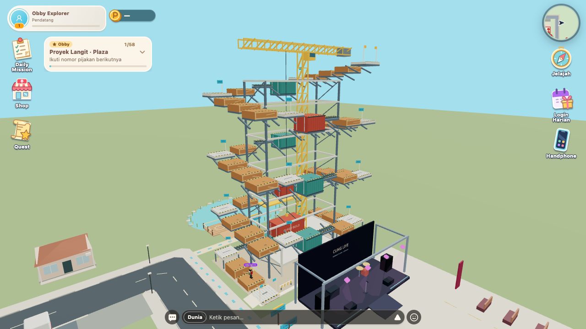

# Plaza Obby — Proyek Langit

Tanggal: 16 Oktober 2026. Implementasi lokal; tidak melakukan deploy atau mengubah reward server.

## Cara bermain

1. Pergi ke Plaza konser **Cung Live** di timur toko. Temukan papan **PROYEK LANGIT** pada sisi barat panggung, sekitar `(28.3, -11.8)` dalam koordinat X/Z.
2. Ikuti trotoar barat panggung ke utara, lewat ujung dinding belakang, lalu belok kanan menuju ramp dan **START** di `(30.3, -17.5)`.
3. Ikuti **59 pijakan** bernomor: peti, scaffolding, balok sempit, kontainer, dan pallet bergerak. Atap 5,1 m kini menjadi **checkpoint 3**, bukan Finish. Lanjutkan tiga putaran pendakian mengitari rangka bangunan, melewati total **14 checkpoint**, sampai Finish **31,5 m**. Sprint tidak diperlukan.
4. Desktop tetap memakai WASD + Spasi. Mobile landscape tetap memakai analog dan satu tombol lompat yang sudah ada. Q/E atau gestur look tetap mengatur orbit kamera.
5. Jatuh mengembalikan karakter ke checkpoint terakhir. Untuk berhenti, kembali ke jalur masuk sebelah barat Start di permukaan tanah. Setelah Finish, terjun dari gedung otomatis membuka **parasut** (turun pelan, bisa diarahkan); mendarat di tanah lalu ikuti strip krem kembali ke Plaza, atau naik Start untuk mengulang. Di depan Start ada tombol QA **TEST · KE FINISH** untuk warp langsung ke Finish (status complete) tanpa mendaki penuh.

## Revisi konstruksi sesuai referensi

Revisi ketinggian memperpanjang 11 pijakan menjadi **59**, dengan Finish dari **5,1 menjadi 31,5 m**. Rangka bangunan terbuka bertingkat mencapai 28,8 m dan crane lattice kuning 33,8 m. Tiga putaran di atas jalur awal masing-masing naik 8,8 m; ruang antar putaran menjaga kepala dan lompatan bebas dari kontainer di atasnya. Ada enam kontainer tambahan, enam balok sempit tambahan, peti, checkpoint berbendera, dan penyangga baja. Geometri tetap memakai primitive/instancing proyek, dalam tapak horizontal yang sama.



Kenaikan antar pijakan maksimal 0,55 m. Lebar beberapa pijakan ditambah agar tetap bisa dijangkau dengan berjalan, tanpa mengubah impuls lompat/gravitasi. Tidak ada perubahan tenaga, tinggi, atau durasi balistik lompat. Celah pada belokan disesuaikan untuk jeda antisipasi lompat yang sudah ada. Peti dan kontainer memakai collider dengan ketebalan badan sebenarnya. Turun lebih dari 1,5 m di bawah pijakan terakhir yang dicapai memicu pemulihan ke checkpoint; pemain tidak perlu menunggu jatuh 30 m. Mendarat pada lantai rangka/barikade juga memulihkan pemain. Melewati sisi jalur Start saat masih tinggi tidak membatalkan run.

Kontainer gantung ikut menghalangi kamera agar tidak menembus badan kontainer. Target pandang merendah secara halus pada sisi utara konstruksi supaya seluruh badan terlihat saat boom kamera memendek; di Start target tetap tinggi agar kamera melewati dinding panggung. Penyangga miring tingkat atas dipasang berpasangan pada tepi pijakan, sehingga tidak menutupi jalur pandang kamera di checkpoint 5 dan 9. Pitch, orbit, zoom, dan kontrol kamera tetap memakai controller yang sama.

Revisi ini diuji melalui 1.392 simulasi Rapier dengan seluruh collider lintasan dan konstruksi, lintasan desktop/mobile lengkap, world Plaza asli, serta regresi logika memancing, analog lari, dan animasi. Bukti revisi ketinggian: `construction-overview.png`, `construction-stage-*.png` (indeks 5/10/18/26/34/42/50/58), `construction-upper-views.json`, serta `construction-browser-report.json` dan `construction-world-report.json`. Artefak jump/obby lama tetap disimpan sebagai riwayat pemeriksaan. Cinematic tidak disentuh; hasil tes cinematic di bawah berasal dari pemeriksaan tugas sebelumnya.

## Perilaku dan keputusan

- Tapak obby berada pada `x=28.5..52.5, z=-30.3..-15.8`, berbatasan dengan utara Plaza, tanpa mengganti scene. Ramp berada di luar trotoar utama. Validator membandingkan tapak dengan jalan, bangunan, spawn, bench/props, dan rute NPC bawaan.
- 59 pijakan mencakup Start, 14 checkpoint, tujuh balok sempit, satu pijakan kinematik dan Finish. Progres hanya bertambah pada kontak atas pijakan yang berurutan. Menyentuh sisi, melintas di bawah, atau langsung ke Finish tidak menyelesaikan run.
- Respawn memakai posisi atas checkpoint yang tetap, menghapus kecepatan jatuh/knockback dan input lompat tertunda. Progres kembali ke checkpoint tersebut; timer run tidak diulang.
- Pijakan bergerak memakai fase waktu bersama dan batas perpindahan per physics step untuk mencegah lonjakan ketika tab kembali aktif. Kecepatan support diteruskan ke pemain agar tidak meluncur dari platform saat diam.
- `WALK=4.2`, `RUN=7.4`, `JUMP=6.4`, gravitasi `-20` dipertahankan. Antisipasi menambah jeda visual 60 ms sebelum impulse; jump yang diterima di tanah tetap dijalankan jika kaki melewati tepi dalam jeda singkat itu. Tinggi/durasi fase balistik tidak dituning ulang.
- Rig Base dan Explorer memakai clip runtime pada mixer yang sama: antisipasi, takeoff dengan dua ayunan tangan pendek, descent balance, landing 140 ms. Gait horizontal tetap berjalan agar kembali ke lari tidak mengulang langkah. Lima puff instanced memberi efek ringan tanpa menulis bone atau transform root pemain.
- Fase jump memakai kanal animasi multiplayer yang sudah ada; perubahan fase dikirim segera agar antisipasi 60 ms tidak hilang pada tick 8 Hz.
- Orbit kamera di sekitar obby naik secara halus ke pitch minimum 0.42 rad agar kamera di Start tidak terjepit dinding belakang panggung. Zoom, yaw, input look, collision sweep, dan smoothing tetap memakai sistem Player yang sama.
- `ObbyTracker` menggunakan `QuestTrackerCard` di host HUD bersama. Finish menggunakan `useQuestCompletion`/`QuestCompleteOverlay`/confetti yang sudah ada. Tidak ada konfigurasi reward obby server; varian latihan menyembunyikan Point/XP dan tidak memutasi saldo, inventory, atau quest lain.

## File revisi ketinggian

- `src/game/obby/model.ts`: 48 pijakan tambahan, ketebalan badan eksplisit, penomoran 14 checkpoint, batas jatuh dan exit berdasarkan ketinggian.
- `src/game/obby/construction.ts`: rangka tinggi, crane 33,8 m, kontainer/peti/balok dan penyangga atas tanpa kolom yang menembus jalur di bawahnya.
- `src/game/obby/PlazaObby.tsx`: label checkpoint dinamis dan papan Start.
- `src/game/player/Player.tsx`: pemulihan jatuh cepat dan exit tanah, memakai controller serta respawn yang sama.
- `scripts/check-obby-{model,layout,browser,world}.mjs`, `tests/fixtures/obby/entry.tsx`: simulasi semua collider, pendakian lengkap dan foto tingkat atas.
- `style-game.md`, direktori QA ini: standar dan bukti pemeriksaan.

## File implementasi keseluruhan

| File                                                                                              | Perubahan                                                                          |
| ------------------------------------------------------------------------------------------------- | ---------------------------------------------------------------------------------- |
| `src/game/obby/model.ts`                                                                          | Data posisi platform, batas, fase mover, transisi run murni                        |
| `src/game/obby/store.ts`                                                                          | Progres session/checkpoint dan completion bersama                                  |
| `src/game/obby/construction.ts`                                                                   | Geometri bangunan/crane/kontainer, material, solid catch surfaces                  |
| `src/game/world/OutdoorBatch.tsx`                                                                 | Rotasi X/Z opsional untuk brace dan truss instanced                                |
| `src/game/obby/PlazaObby.tsx`                                                                     | Scene, instanced geometry, collision, ramp, tanda, bendera                         |
| `src/game/player/movement.ts`                                                                     | Konstanta movement lama yang dibagi dengan pengujian                               |
| `src/game/player/Player.tsx`                                                                      | Support ray, fase jump, carry platform, respawn, framing kamera                    |
| `src/game/engine/GameCanvas.tsx`                                                                  | Memasang obby hanya di dunia luar; gravitasi memakai konstanta bersama             |
| `src/game/avatar/jump-clips.ts`                                                                   | Clip jump untuk bone/pivot yang sudah ada dan timing blend                         |
| `src/game/avatar/JumpPuffs.tsx`                                                                   | Efek takeoff/landing yang dipakai pemain lokal/remote                              |
| `src/game/avatar/BaseAvatarV2.tsx`, `ExplorerAvatar.tsx`, `explorer-clips.ts`, `avatar-source.ts` | Integrasi clip, gait, efek, dan tipe animasi                                       |
| `src/game/net/RemotePlayers.tsx`                                                                  | Validasi fase, prioritas jump, gait horizontal, pengiriman fase segera             |
| `src/ui/hud/ObbyTracker.tsx`, `Hud.tsx`                                                           | Progres ringkas pada host yang sama                                                |
| `src/ui/quests/QuestCompleteOverlay.tsx`                                                          | Varian penyelesaian latihan tanpa reward                                           |
| `style-game.md`                                                                                   | Standar tracker obby dan animasi/efek jump                                         |
| `scripts/check-obby-browser.mjs`, `tests/fixtures/obby/entry.tsx`                                 | Pengujian kontrol nyata, termasuk assertion physics desktop 60 Hz dan mobile 40 Hz |

Perubahan dance, mascot, identity, dan NPC yang sudah ada sebelum tugas dipertahankan. Cinematic opening dan kontrol keyboard/mobile tidak diedit.

## Pengujian yang dapat diulang

```sh
npx tsc --noEmit
npm run build
node scripts/check-obby-layout.mjs
node scripts/check-obby-model.mjs
node --test tests/jump-animation.test.mjs tests/jump-remote.test.mjs tests/explorer-rig.test.mjs
node scripts/check-obby-browser.mjs
node scripts/check-obby-world.mjs
node scripts/check-jump-browser.mjs
node scripts/check-intro-browser.mjs
node scripts/check-world-intro-gate.mjs
```

Browser harness memerlukan Chrome/Playwright dan izin membuka server localhost. Transport backend dipalsukan di fixture; `Player`, Rapier, rig, HUD, dan kontrol yang diuji berasal dari implementasi produksi. Fixture world memasang `OutdoorNeighborhood` dan `ConcertSet` yang sebenarnya. Fixture browser juga memakai gravitasi bersama serta timestep produksi: 60 Hz pada desktop dan 40 Hz pada mode ringan mobile. Harness memeriksa timestep Rapier yang benar-benar berjalan dan menuliskannya sebagai `physicsHz` dalam laporan JSON.

Pengujian tambahan: ESLint pada file yang disentuh, `git diff --check`, `check-chat-emotes.mjs`, `check-dance-clips.mjs`, dan `check-road-network.mjs`.

## Hasil dan batas verifikasi

- Revisi ketinggian: TypeScript, production build, lint terarah, model/layout obby, serta 12 tes jump/remote/analog-lari/memancing lulus. Pemeriksaan chat-emote, delapan dance, dan road-network tercatat lulus pada tugas sebelumnya.
- Simulasi Rapier: **1.392 traversal**, kecepatan jalan biasa, physics **40/60 Hz**, 12 fase pijakan bergerak. Start/urutan/checkpoint/Finish/replay juga diuji.
- Browser Chrome **1280×720 desktop (physics 60 Hz)** dan **740×360 mobile landscape (physics 40 Hz)**: ramp, seluruh 58 transisi, jatuh alami/respawn pada **seluruh 14 checkpoint**, carry saat diam di mover selama tiga detik, Finish tanpa reward, satu tombol jump, serta tracker tidak menutupi kontrol. Input memakai keyboard atau sentuhan dua jari yang sebenarnya di browser, bukan mengisi progres store.
- Rute dengan lingkungan Plaza asli lulus: `(29, -8.5)` → trotoar `(26.2, -8.5)` → `(26.2, -17.5)` → ramp/Start. Kamera Start dan step1 menjaga jarak sekitar **11.47 m**, dengan avatar dan platform tetap terlihat. Sudut pandang tambahan diperiksa pada pijakan 5, 10, 18, 26, 34, 42, 50, dan Finish 58.
- Jump diam terukur **sekitar 1 m pada desktop dan mobile 40 Hz**; pergeseran kamera per frame diperiksa di bawah 0,6 m pada uji stationary jump. Perbedaan kecil tinggi mengikuti integrasi timestep, dengan impulse dan gravitasi produksi tetap sama. Frame trace memperlihatkan dua ayunan pendek lengan, pose turun stabil, dan landing. Screenshot serta trace tersedia di `/tmp/toko-obby-qa` dan `/tmp/toko-jump-qa`.
- Cinematic tidak diedit pada revisi ketinggian. Playback/gate, skip/replay, portrait–landscape, offline retry, dan recovery lulus pada harness Chromium/WebKit dalam pemeriksaan sebelumnya; tidak diklaim diuji ulang pada revisi ini.
- Regresi multiplayer menjalankan callback produksi `RemotePlayers` dengan transport terkontrol: empat fase terkirim segera, tetap throttled ketika tidak berubah, diterima remote, dan tidak membuat jump vertikal diam berubah menjadi animasi lari.
- **Belum diverifikasi:** perangkat mobile fisik/performa GPU nyata, dua akun multiplayer melalui server Cloud langsung, dan target NPC/POI/SPAWN tambahan yang hanya tersimpan di registry Cloud. Pemeriksaan penempatan mencakup layout yang tersedia di repository.

Suite lama belum sepenuhnya hijau: baseline `node --test tests/*.test.mjs` memiliki empat kegagalan (manifest GLB tidak sinkron, dua assertion Root dance lama, dan resolusi import `road-path`). Pemeriksaan tambahan menemukan fixture lama `check-world-plan.mjs` masih mengharapkan 14 NPC (working tree memiliki 15), `check-quest-trackers.mjs` belum menyediakan dependency `PointCoinIcon`, dan loader `check-state-protocol.mjs` menggandakan ekstensi menjadi `explorer.ts.ts`. File/asersi tersebut tidak diubah untuk menutupi kegagalan.
