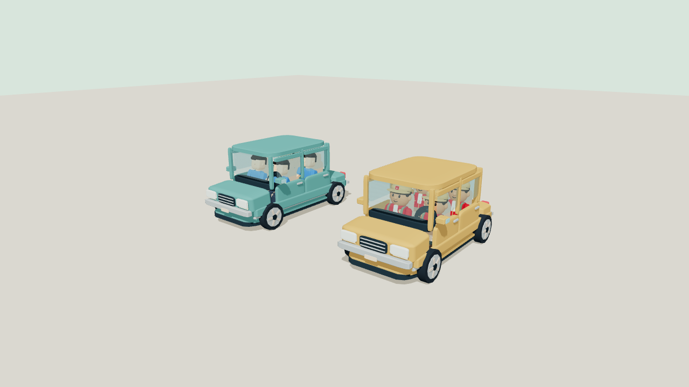
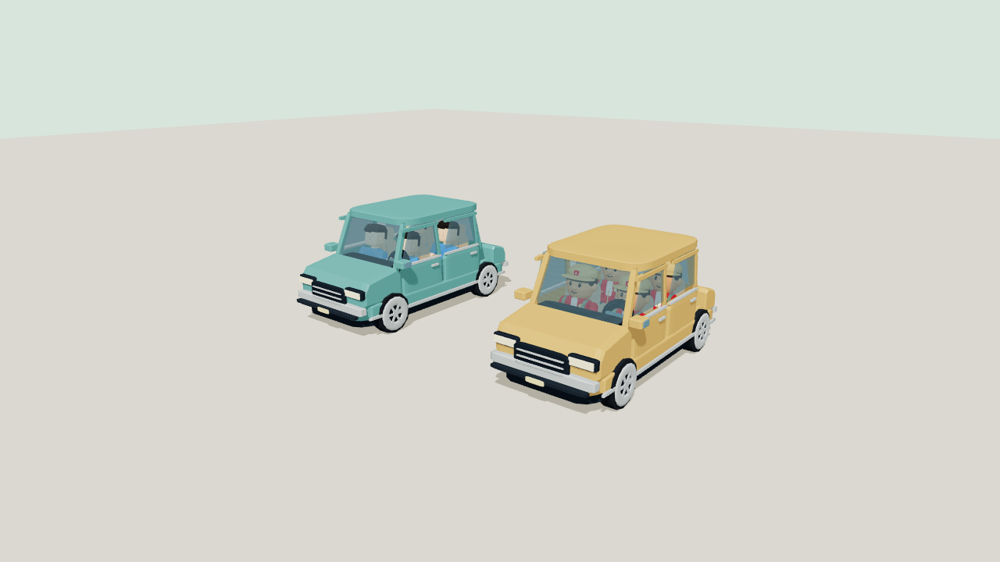
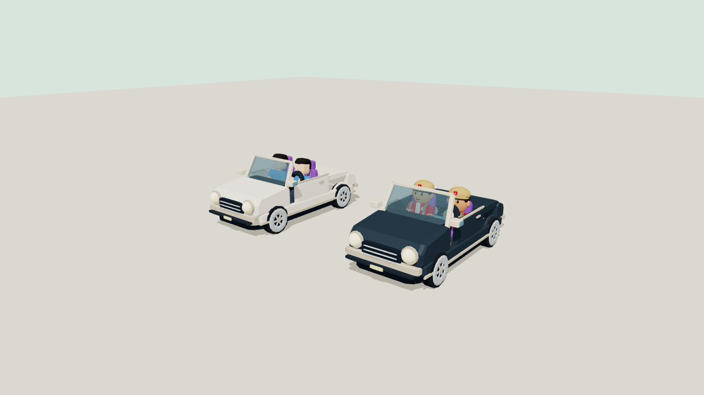
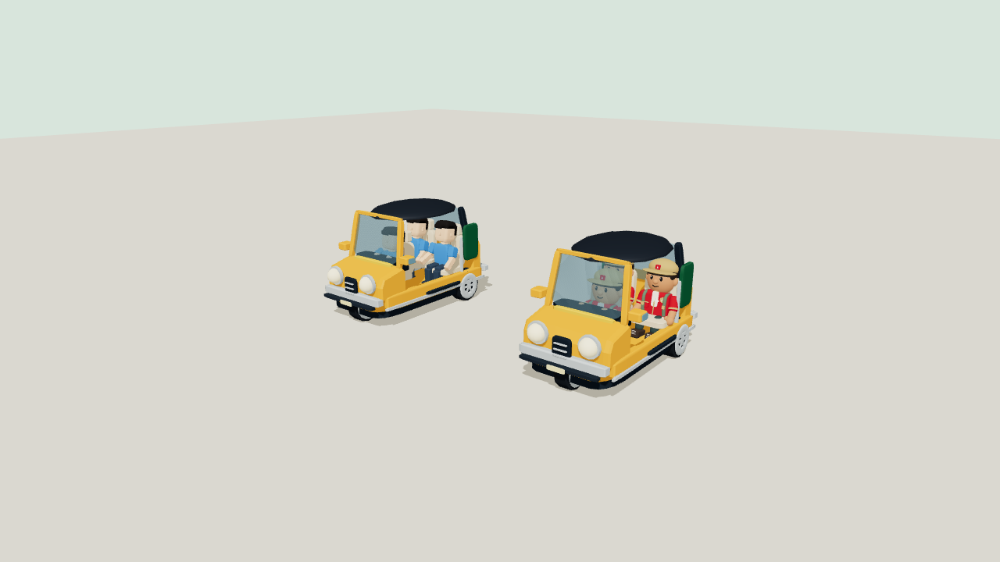
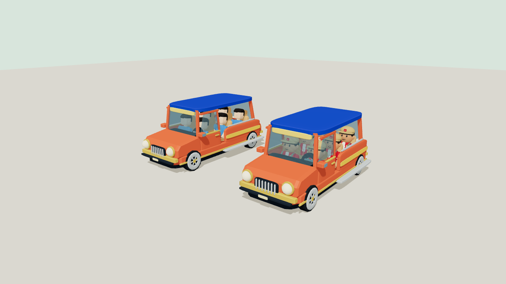
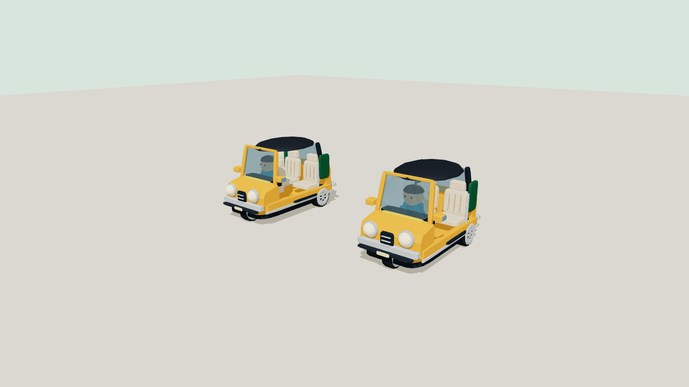

# Reference vehicle fleet — 9 November 2026

All eight existing shared vehicle models were revised; the user explicitly added convertible, bajaj and jeepney to the scope. Models have sloped bonnet profiles/windshields, fenders, rims, detailed lights and distinct cabins. All automatic traffic now has a seated NPC driver; player/shared parked vehicles do not.

| Model | Total player seats | Main silhouette |
| --- | --- | --- |
| Hatchback / MPV | 4 each | Sloped glass, separate bonnet, shaped lamps and wheel arches |
| Pickup | 4 | Crew cab and open bed |
| Angkot | 4 | Tall cabin, route sign and side stripe |
| Bebek / matic | 2 each | Separate body/fairing, footrests, bars and mirrors |
| Van / truck | Existing staged/traffic/delivery use | Panel van; truck cab with box or open bed |
| Convertible | 2 | Open roof, purple seats, round lamps, chrome trim |
| Bajaj | 3 | One front/two rear wheels, black canopy, orange body |
| Jeepney | 6 | Long open cabin, blue roof, vertical chrome grille, running boards |

## Visual evidence

| Previous shared car | Revised car |
| --- | --- |
|  |  |

[Gallery](gallery/) contains 44 front/side/rear/three-quarter captures for all 11 models with Base/Explorer occupants, plus 11 NPC-driver captures. Truck views show both enclosed cargo and delivery flatbed. These are original procedural models guided by the supplied references, not imported Play Together assets.

## Validation

- TypeScript and production build passed.
- Actual Base/Explorer rig fit for every seat and Explorer headwear, driver grip reach, legacy seat/transition endpoints and shared suspension: [fit data](vehicle-fit.json).
- Two-player browser QA with actual Player/Rapier/HUD and Laravel mobility services: MPV camera regression, wall/other-vehicle camera collision, blocked door, repeated input, consent/driving/brake/exit, motorcycle multitouch/disconnect. Convertible, bajaj and jeepney each board two players, drive about 1.56 m under physics and release both on driver exit at their actual parking coordinates: [report](driving/report.json).
- NPC parts exist on all 11 models, hands coincide with the control grips, and no driver is generated for parked/player vehicles. The 33 existing traffic IDs remain; all new variants occur in the automatic fleet. Traffic/queue/handoff and all six road-route checks passed.
- Coastal layout and water-contact guards passed. Character scale, quest/economy rules and store layout are unchanged.
- Backend focused suite: **18 tests / 104 assertions**. Covers upgrading six-slot rooms to nine without changing old IDs, idempotent spawning, legacy-model filtering, capacities 2/3/6, consent/full-seat rejection and complete party exit.

## Performance and limits

Same map route/settings as the previous cartoon-world capture: Chrome headless SwiftShader, 844×390 touch, DPR1, LOW initial tier, fixed lighting, shadow maps off. Store/market/park/return draw calls: **593 / 612 / 616 / 593**, up at most **4.22%**. Frame p95: **17.4 / 17.3 / 17.5 / 17.4 ms**, up at most **0.57%**, with rounded 60 FPS. Triangles: 445,772–458,326. Budgets remain ≤15% calls and ≤10% p95. [Raw final data](performance/after.json); baseline is [previous cartoon-world result](../cartoon-world/after.json).

The paired map fixture does not elect a moving-traffic network host. Separately, the actual vehicle renderer was measured with NPCs off/on: each NPC adds **4 draw calls including the shadow pass** (8 for the two-vehicle gallery), across all 11 models; see [gallery.json](gallery/gallery.json).

These are browser/fixture measurements, not physical-phone, production-transport or full-room-load results. The six-seat jeepney has numeric/gallery coverage for all seats and backend six-person reservation/exit coverage; live browser movement uses two clients, not six. NPCs use batched geometry and near detail instead of extra full avatar rigs. No production deployment was performed.

## Release

Backend first, then frontend and refresh/rejoin rooms. No migration or seed. The current frontend advertises nine supported player models; the server adds three guaranteed slots and sends expected pool size. Existing legacy clients only see the six-slot compatible fleet, so a backend-first rollout does not send unknown models to them. New parked vehicles are near the city park at `(81,79)`, `(81,85)` and `(81,92)`.
