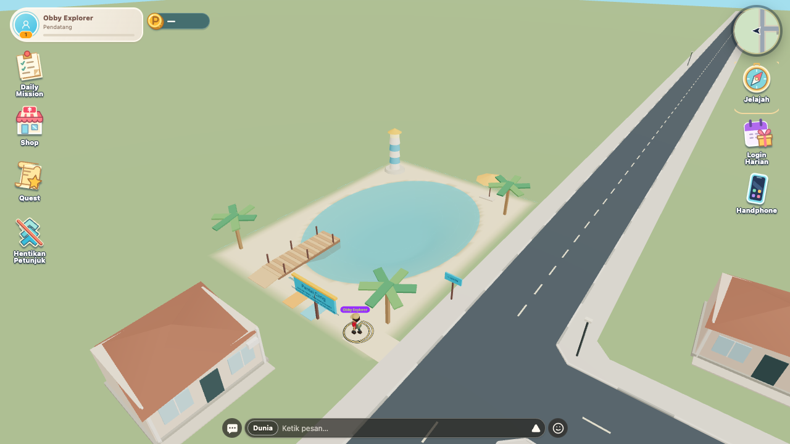

# Pantai Cung dan berenang

Implementasi lokal, 16 Oktober 2026. Tidak melakukan deploy atau mengubah backend/reward.

## Lokasi dan akses

Orientasi koordinat repository menetapkan timur pada **+X**, sedangkan kiri kamera awal berada pada **−X**. Pengguna memilih **kiri map, lahan kosong kiri-utara** setelah perbedaan ini dikonfirmasi.

Pantai berada pada `x=-54.5..-35.5, z=-54.5..-27.5`; laguna berpusat di `(-45, -42)` dengan radius X/Z `7.6/10.3 m`. Area ini kosong dalam layout repository, di sebelah barat Jalan Kampung dan utara rumah warga. Tidak ada rumah, quest, obby, dermaga memancing, jalan, atau spawn yang dihapus/dipindah. Batas map ±56 tetap.

Dari **Jelajah → Pantai Cung**, ikuti panah melalui sisi barat Plaza `(26.2, -8.5)`, trotoar utara `(26.2, -36.2)` → `(-34.2, -36.2)`, lalu ke pintu masuk `(-38, -29)`. Papan Pantai tersedia di Plaza, belokan trotoar, dan pintu masuk. Penunjuk melakukan belokan pertama sebelum dinding panggung.

Venue berupa laguna berpasir dengan tepi landai, dermaga ber-ramp, pohon palem, mercusuar kecil, payung, dan alas duduk. Desain menggunakan primitive/instancing yang sudah dipakai game, bukan aset referensi yang disalin.



## Kontrol dan aturan air

- **Desktop:** WASD untuk mengarah; Spasi mengayuh ke atas. **Mobile landscape:** analog yang sama dan satu tombol lompat yang sama. Tidak ada HUD/tombol tambahan.
- Air dangkal tetap memakai jalan/lari yang diperlambat. Berenang aktif ketika dasar cukup dalam (≥1,05 m) dan kaki benar-benar terendam (>0,9 m). Ambang keluar 0,72 m mencegah status berkedip di perbatasan.
- Di dalam air, karakter mengapung otomatis; tidak perlu menahan input. Kayuhan memberi kenaikan singkat sekitar 0,25 m. Bergerak ke tepi landai mengembalikan kontrol darat dan gravitasi normal; Spasi kembali menjadi lompat biasa.
- Air tidak dianggap dalam hanya karena berada di bawah pemain: karakter di dermaga atau melompat di atas air tetap memakai keadaan darat/udara sampai benar-benar masuk air.
- Kedalaman maksimum 2,2 m. Permukaan air `y=-0.08`; pusat capsule mengapung di `y=-0.18`, bukan posisi kaki. Dasar mesh dan collider memakai grid yang sama, dengan dasar pengaman tambahan. Lereng tersedia di seluruh tepi, bukan satu pintu sempit.
- Fishing Spot lama tetap dangkal (sekitar 6,5 cm) dan tidak menjadi zona berenang. Jalan masuk, dermaga, serta alur memancing dipertahankan.
- Swim/SwimIdle memakai AnimationMixer yang sama pada rig Base dan Explorer. Sistem penapak kaki dinonaktifkan ketika berenang; tidak ada controller karakter atau penulis bone kedua. Pose dikirim melalui kanal multiplayer yang sudah ada dan mengalahkan pose sosial lama.
- Cipratan memakai enam droplet instanced dan satu riak yang dipakai ulang, tanpa efek layar. Air memakai satu permukaan transparan dan tiga garis riak, tanpa refleksi/postprocessing tambahan.

## Pengujian

```sh
node scripts/check-swimming-layout.mjs
node --test tests/swimming.test.mjs tests/jump-animation.test.mjs tests/jump-remote.test.mjs tests/running-fishing.test.mjs
node scripts/check-swimming-browser.mjs
node scripts/check-swimming-world.mjs
node scripts/check-obby-model.mjs
node scripts/check-obby-layout.mjs
node scripts/check-obby-browser.mjs
node scripts/check-fishing-browser.mjs
npx tsc --noEmit
npm run build
```

Harness browser memakai Player/Rapier/rig/HUD/kontrol produksi dan world asli. Transport backend menggunakan fixture; hasil ini tidak membuktikan layanan Cloud atau dua akun live. Browser desktop 1280×720 pada physics 60 Hz, mobile landscape 740×360 pada physics 40 Hz. Pengujian transisi memakai keyboard atau sentuhan analog/tombol dua jari; hanya posisi awal diatur oleh fixture.

Hasil berenang desktop dan mobile: darat → dangkal → dalam → diam mengapung → kayuh → bergerak → dangkal → darat lulus. Lompatan darat setelah keluar, masuk dari ujung dermaga, keluar di tepi barat, dan batas map juga lulus. Pusat karakter saat mengapung terukur `-0.18 m` pada kedua mode; kayuhan naik sekitar `0.247/0.250 m` desktop/mobile. Seluruh sambungan grid dasar ke tanah luar rata pada `y=-0.04`.

Validator penempatan membandingkan tapak dengan bangunan, jalan/trotoar, props, spawn, kendaraan statis, serta lintasan NPC yang tersedia di repository. Rute berjalan dari Plaza ke pantai juga diuji di world asli. Lalu lintas jalan tetap aktif; pemain tetap perlu memperhatikan kendaraan saat menyeberang.

TypeScript, production build, ESLint terarah, dan 18 tes logika/animasi lulus. Regresi obby lulus untuk seluruh 58 transisi dan 14 checkpoint pada desktop serta mobile, ditambah 1.392 simulasi Rapier. Regresi browser memancing/analog lari juga lulus pada kedua viewport, memakai transport koleksi fixture.

Regresi animasi mencakup binding seluruh joint, loop swim, root tetap, lari analog, lompat, serta pengiriman/penerimaan pose remote. File cinematic tidak disentuh; playback opening tidak diuji ulang dalam tugas ini.

## File yang diubah dalam tugas berenang

| Area                                              | File                                                                                                                                                     |
| ------------------------------------------------- | -------------------------------------------------------------------------------------------------------------------------------------------------------- |
| Kedalaman, buoyancy, geometri dasar, navigasi     | `src/game/swimming/model.ts`                                                                                                                             |
| Memotong tanah hanya di tapak pantai, dasar fisik | `src/game/swimming/BeachGround.tsx`, `src/game/world/OutdoorNeighborhood.tsx`                                                                            |
| Venue dan pemasangan scene                        | `src/game/swimming/SwimmingBeach.tsx`, `src/game/engine/GameCanvas.tsx`                                                                                  |
| Integrasi kontrol berenang                        | `src/game/player/Player.tsx`                                                                                                                             |
| Clip dan efek                                     | `src/game/avatar/swim-clips.ts`, `src/game/avatar/WaterSplash.tsx`                                                                                       |
| Integrasi kedua rig/grounding                     | `src/game/avatar/BaseAvatarV2.tsx`, `ExplorerAvatar.tsx`, `explorer-clips.ts`, `avatar-source.ts`, `grounding.ts`                                        |
| Sinkronisasi pose                                 | `src/game/net/RemotePlayers.tsx`                                                                                                                         |
| Destinasi Jelajah/panah yang sudah ada            | `src/ui/hud/ExplorePanel.tsx`, `src/state/game-store.ts`, `src/game/core/use-world-guidance.ts`, `QuestGuidance.tsx`, `src/game/navigation/Waypoint.tsx` |
| Pemeriksaan                                       | `scripts/check-swimming-{layout,browser,world}.mjs`, `tests/swimming.test.mjs`, `tests/jump-remote.test.mjs`, `tests/fixtures/obby/entry.tsx`            |
| Panduan/bukti                                     | `style-game.md`, direktori ini                                                                                                                           |

Belum diverifikasi: perangkat Android/iOS fisik, performa GPU nyata, dua akun multiplayer live, dan objek/quest tambahan yang hanya ada pada registry Cloud. Tidak ada klaim deploy atau perubahan data persisten.
