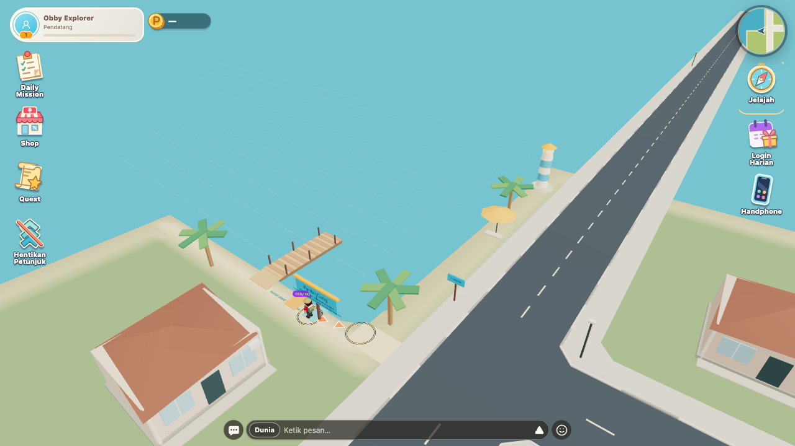

# Pantai Cung: pesisir terbuka

Pembaruan lokal, 16 Oktober 2026. Pantai kini berada di tepi barat laut kota, terbuka ke utara dan barat. Tanah di luar kota diganti laut sampai horizon; pantai tidak lagi berbentuk kolam oval dengan tanah di sekelilingnya.



## Bentuk dunia

- Kota memiliki batas daratan ±64 m, dengan garis pantai barat laut pada `x=-38` dan `z=-29`. Dasar pantai turun landai selama 12 m, sampai kedalaman air 3,2 m.
- Permukaan laut membentang sampai ±2.000 m. Batas gerak dunia dipindah dari ±56 m ke ±180 m sehingga pemain bisa berenang melewati tepi pantai lama.
- Bangunan, spawn, aktivitas, dan lintasan NPC tetap di daratan. Jalan/trotoar yang memanjang ke laut memiliki collider dari geometri permukaan yang sama sehingga tetap dapat dilalui.
- Palem, payung, dan mercusuar disesuaikan ke daratan pesisir. Dermaga dan ramp tetap dapat digunakan; berdiri di atasnya tidak memicu berenang.
- Minimap ringkas dan detail memakai garis pantai yang sama dengan model dunia. Fishing Spot memiliki dasar/perairan terpisah dengan kedalaman 2,2 m dan juga dapat dipakai berenang.
- Laut memakai permukaan opaque dan garis ombak ringan. Dasar mesh dan collider berbagi geometri; tidak ada bidang tanah datar yang menutup laut atau kolam memancing.

Akses tetap melalui **Jelajah → Pantai Cung**, tujuan `(-38, 0, -29)` dengan petunjuk lewat trotoar utara/barat kota.

## Kontrol

WASD atau analog menggerakkan pemain. Berenang otomatis saat cukup dalam dan kaki terendam; Spasi/tombol lompat mengayuh. Pemain mengapung saat diam. Mendekati tepian landai mengembalikan jalan dan lompat. Ambang masuk 1,05 m dan keluar 0,72 m mencegah perpindahan animasi berulang di tepian.

## Verifikasi perubahan pesisir

```sh
node scripts/check-swimming-layout.mjs
node --test tests/swimming.test.mjs tests/jump-animation.test.mjs tests/jump-remote.test.mjs tests/running-fishing.test.mjs
node scripts/check-swimming-browser.mjs
node scripts/check-fishing-browser.mjs
npx tsc --noEmit
npm run build
```

23 tes logika/animasi lulus. Validator penempatan memastikan pusat lot dan lintasan NPC tetap kering serta tapak kolam memancing tidak tertutup objek lain. Browser memakai Player/Rapier/HUD/world produksi dengan transport backend fixture: desktop 1280×720 (60 Hz) dan landscape mobile 740×360 (40 Hz).

Uji browser mencakup darat → dangkal → dalam, diam mengapung, kayuhan, keluar lewat pantai, lompat setelah keluar, akses ramp/dermaga, masuk air dari ujung dermaga, berenang melewati dinding lama, serta mengapung jauh di luar mesh pesisir. Jalan dan trotoar di atas laut juga diperiksa agar pemain tidak menembus permukaan. Regresi memancing desktop/mobile memeriksa posisi di dermaga, tangkapan, retry, dan kontrol lari.

Bukti terbaru: [hasil pengujian](open-coast-report.json), [tampilan mobile](open-coast-mobile.png). Screenshot/laporan lain di direktori ini berasal dari implementasi pantai terdahulu.

Belum diverifikasi: perangkat Android/iOS fisik, performa GPU nyata, dua akun multiplayer live, dan objek tambahan dari registry Cloud. Pengujian lokal dan push Git tidak membuktikan deploy produksi.
