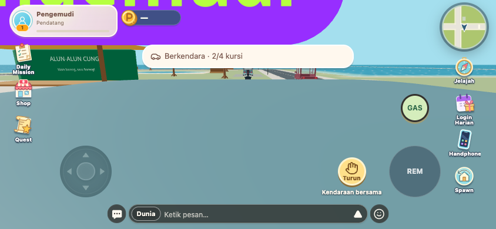
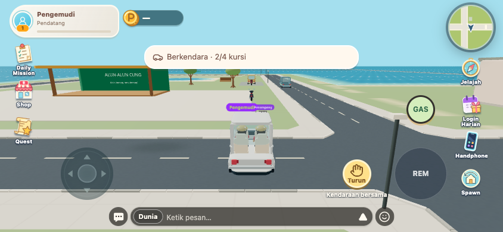

# Vehicle camera regression — 9 November 2026

The MPV/angkot roof collider reaches into the 0.18 m camera sweep around the 2.3 m focus point. The mounted camera was treating its own vehicle as an obstruction, reporting an immediate hit and shortening its boom to 0.3 m. This put the lens into the car and enlarged the avatar nameplate.

The mounted camera now excludes the occupied `rideId` only. Existing pass-through objects retain their behavior; walls and other vehicles still obstruct the camera. On-foot camera behavior is unchanged. The fix is frontend-only and needs no backend/migration change.

| Before | After |
| --- | --- |
|  |  |

## Verification

`WORLD_QA_BACKEND=/path/to/backend QA_OUTPUT=docs/qa/vehicle-camera/after node scripts/check-vehicles-browser.mjs`

The existing real-physics two-player harness now pins slot 0 to MPV in its disposable SQLite database. Random short-roof variants previously hid the problem. Auth/transport are local fixtures; Player, Rapier, HUD and Laravel mobility services are the actual implementation.

- Before fix, the new assertion failed: driver and passenger camera distance **0.30 m**.
- After fix: both camera distances **11.10 m**, outside the occupied vehicle while seated and driving.
- A wall and a distinct `rideId` collider in the camera path each shorten the boom to **2.73 m**. Removing either restores normal distance.
- Existing consent, door obstruction, repeated input, driving/braking, passenger following, independent exits, motorcycle multitouch and disconnect checks passed. No browser page errors. [Raw report](after/report.json).
- TypeScript and production build passed; no physical-phone or production smoke test. No deployment performed.
